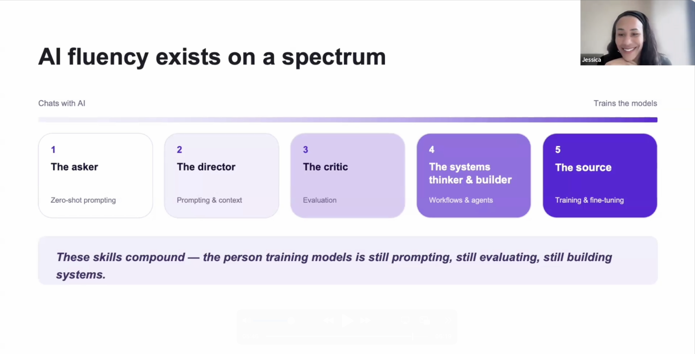
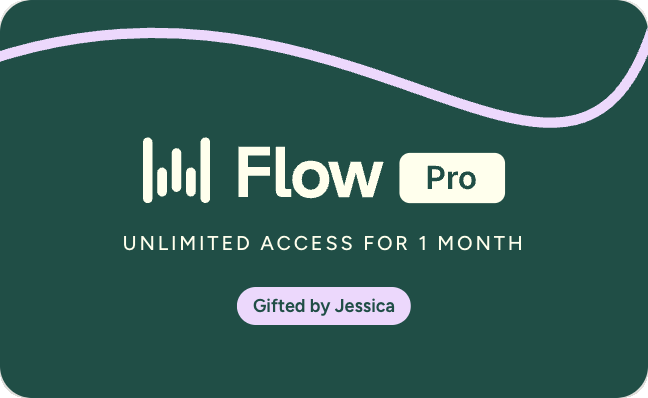

  

---

  

### I talk more than I type

Most of what I write starts as dictation in [Wispr Flow](https://wisprflow.ai/r?JESSICA5292) — notes, docs, prompts, half my commits. It keeps up with how fast I talk, strips the filler words, formats as it goes, and works in whatever app I'm already in.

The Notetaker is the part I didn't expect to love. It works out on its own when I've joined a meeting, asks whether I want notes, and then takes them — transcript and a summary once the call ends.

I genuinely love this product. It's evolved how we interact with our devices.

**[Grab a free month of Flow Pro →](https://wisprflow.ai/r?JESSICA5292)**
